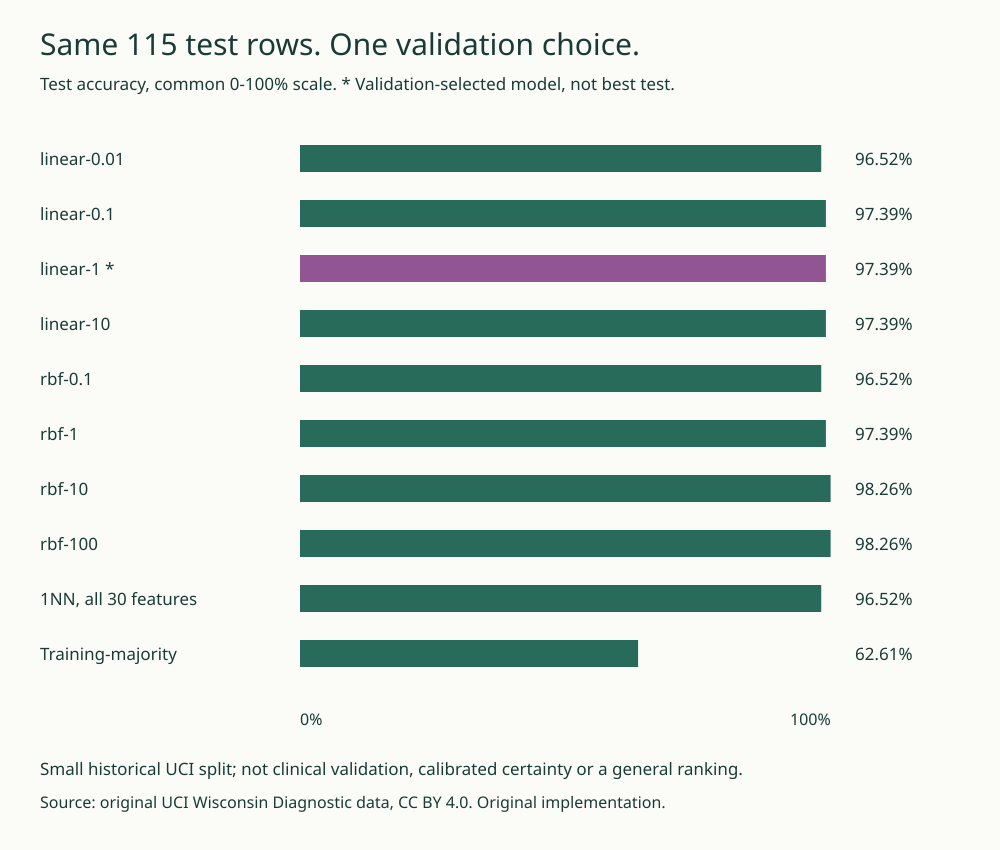

# MarginLab

**A correct label is not a solved optimization problem.**

[Live 30-feature margin inspector](https://midya8.github.io/marginlab/) · [Equations, protocol and limits](METHOD.md)

Soft-margin SVM learning from scratch on licensed public UCI data. Two-variable dual updates preserve a linear equality and box constraints; each fit exposes primal/dual values, numerical KKT/feasibility residuals and every accepted pair. NumPy supplies arrays, not an SVM solver. No sklearn SVM, model API, private dataset or diagnostic product.

> Educational historical-data engineering exercise only. Not clinical validation, medical advice, calibrated probabilities or deployment readiness. Original identifiers are excluded from features and browser data.

## What is real

- Linear and RBF kernels, analytic bounded pair updates, explicit zero-curvature endpoint handling, full pair replay, separate numerical gap and feasibility checks.
- Eight fits on a frozen 341/113/115 class-stratified split. Training-only scaling and validation-only selection; no validation refit. All candidates visible.
- Independent scalar JavaScript inference on all 30 editable features, signed feature/kernel terms, honest two-feature decision slices and original-unit inputs.
- Accuracy-versus-optimization, zero-curvature and nonunique duplicate-support controls.
- An independent exact-rational active-face KKT oracle for 60 tiny problems. No claim of an exact certificate for the floating-point real-data fits.

## The result, including the inconvenient part

Validation selects linear C=1: **112/115** test labels correct. Full-30D 1NN gets **111/115** and training-majority **72/115**. RBF C=10 and C=100 each get **113/115**, but are not picked using test scores. This is one small historical split, not a general model ranking or clinical evaluation. Every original candidate is retained.



All eight fits meet both explicit numerical KKT/gap tolerances. A norm/margin score is not a probability, and a small optimization gap does not bound clinical or generalization error. With duplicate examples, different support coefficients can produce the same optimum, so alpha is not unique causal data importance.

## Reproduce

Python 3.10+; NumPy pinned to 2.2.6. Runtime is offline. Original data and losslessly encoded source metadata with hashes are bundled under CC BY 4.0; code is MIT.

```sh
python -m pip install -e .
OPENBLAS_NUM_THREADS=1 python -m unittest discover -s tests -v
python -m marginlab report
python -m marginlab audit
python -m marginlab fit --output fresh.json
python -m marginlab audit --report fresh.json
python -m marginlab controls
node --test tests/*.cjs
```

The actual Chrome checks require Chrome and Node 22+. Set `CHROME_BIN` when needed. Independent checks cover 60 rational active-face optima, every accepted pair, eight full fresh refits, frozen-holdout poisoning, all 4,552 native/browser score comparisons, scalar kernels, symmetries, strict JSON errors and real keyboard/copy/download/mobile behavior. Floating values are checked with stated tolerances, not promised bitwise portability across platforms.

Strict prediction input is `{"samples":[[30 original-unit numeric feature values]]}`. Booleans, strings, nonfinite values, duplicate keys and unknown fields fail.

```sh
python -m marginlab predict --input samples.json
python -m marginlab predict --input samples.json --model-id rbf-10
python -m marginlab fit --budget 0 --output unfinished.json
python -m pip wheel . --no-deps -w /tmp/wheels
python -m pip install --target /tmp/installed /tmp/wheels/marginlab-0.1.0-py3-none-any.whl
bash examples/verify_wheel.sh /tmp/installed "$PWD"
```

The wheel check imports all seven modules including the package root and exercises all five commands outside checkout, including eight fresh fits and saved/fresh full replay audits. The browser exporter recreates public data/references without refitting: `python -m marginlab.export`. The score figure is reproducible with `python examples/figure.py`.

## Inspect the limits

An SVM score is signed, not calibrated certainty. The first-two-feature plot holds the other 28 features at their training means; it is a decision slice, not a projection. Points overlay only two coordinates. An edited input can be implausible. Synthetic controls are not causal ablations, source labels are historical targets, and a few errors on 115 examples do not establish medical reliability.

The optimizer uses a deterministic maximum-violation pair choice, not every heuristic from Platt's original SMO. Dense Gram storage is quadratic; no large-scale speed claim. `budget_exhausted` and `no_progress` remain distinct from numerical tolerance. All formulas, source attribution, C sum-loss convention, exact source hashes and original UCI license are in [METHOD.md](METHOD.md).

## Bounded artifact storage

The complete report is assembled from `marginlab/artifacts/report.json`, eight readable per-candidate JSON files and three bounded linear-10 pair chunks. `saved()` restores all original values and pair order. Each stored text file is below 600 KB to avoid large-file browser-editor truncation. Fresh `fit --output` still writes one complete ordinary JSON report. The source names text is stored as a JSON string so its exact original bytes, including its missing final newline, survive text-editor normalization. Both original source hashes are verified after decoding. This is storage only, not a refit, rounding or change of protocol.
